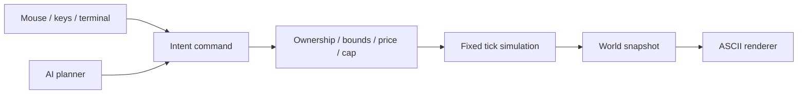

# Architecture and game rules

## Data flow

Offline browser: all these pieces run in one browser. Offline native: C owns the
rules and raylib owns input/drawing; C++, Python and Lua call the same bridge.
Offline Godot: GDScript owns both rules and rendering but keeps functions separate.
LAN: only Node runs rules; clients submit orders and consume JSON snapshots.

## State model

`Game` contains a monotonically increasing tick, credits for two sides, a winner,
an entity list, and (browser/Godot) walls and ore deposits. The grid is 40×24.
Browser entities use stable integer `id`s. Native entities use array indices into
120 slots; dead slots can be reused, so a production native selection system
should add generations or clear dead selections before slot reuse.

An entity contains owner, kind, grid position, health, current order and attack
cooldown. Native orders store destination and gather flag directly. Browser and
Godot orders are dictionaries with `type`, `x`, `y`. JSON snapshots are ordinary
data; no executable code travels over the network.

| Rule | Value |
| --- | --- |
| Simulation | 10 ticks/s (100 ms each) |
| Movement | One grid cell every 3 ticks |
| HQ health | 180 |
| Worker | Cost 30, health 35, damage 2, attack range 1 |
| Soldier | Cost 40, health 60, damage 9, attack range 3 |
| Weapon cooldown | 5 ticks |
| Population | 60 entities per side, including HQ |
| Economy | Worker within one Manhattan cell earns 1 credit every 3 ticks |
| Winner | Last side with an HQ; simultaneous HQ destruction is a draw |

Production is immediate. Harvest credits are transferred directly; workers do
not carry ore back to a building. Range uses Manhattan distance, attacks ignore
line of sight, and units may overlap. Those simplifications are explicit rules.

## Tick order

1. Ignore ticks after game over.
2. Increment time; reduce attack cooldowns.
3. For each mobile unit, acquire a nearby enemy and schedule damage if ready.
4. On movement ticks, gather or move one legal step toward the current order.
5. Apply accumulated damage, remove dead units and evaluate surviving HQs.

Damage is accumulated before health changes so mutually lethal attacks resolve
in the same tick. Target selection uses entity order. Movement occurs inside the
unit loop, so later entities can observe earlier movement; this is reproducible
within each implementation but is not a guarantee of cross-engine lockstep or
perfect combat symmetry. A future rules version can read from an immutable
start-of-tick position snapshot for fully simultaneous movement/targeting.

The browser offline AI plans every 20 ticks before the next tick; the native AI
plans inside its tick at that interval. They are intentionally separate teaching
variants. LAN always uses the JavaScript rules and AI, regardless of client.

## Navigation

`nextStep` / `next_cell` runs four-neighbor BFS and records each visited cell's
first step from the start. Returning only that step is simple and robust when
orders change. Complexity is O(width × height) per query, and temporary storage
has the same bound. Walls are impassable; other units are not obstacles.

For thousands of units: store grid occupancy in compact arrays, cache paths until
terrain changes, use A*, use a spatial index for targets, and consider flow fields
for groups moving to one goal. Profile costs before adding those systems.
Native teaching rules use horizontal-then-vertical movement on an open map.

## Rendering and fonts

Browser Canvas uses `monospace`; raylib uses its built-in bitmap font; Godot uses
its built-in fallback font placed in fixed-width cells. The game ships no font or
image assets. You may supply a licensed monospaced font later; keep it separate
from source and record its license. Rendering only reads state. Network clients
must not simulate opponent state independently.

## Deliberate limits

One match per process; no saves, lobby UI, base placement, fog, build queue,
formations, terrain editing or deterministic cross-language replay format.
Native windows and desktop inputs are the supported interaction model. Browser
buttons scale with the page, but touch-only selection is not implemented.
